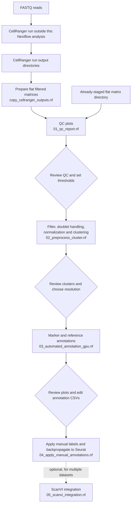

# scrna-seq-pipeline

# Pipeline details

This repository contains staged single-cell RNA-seq analysis workflows. CellRanger runs upstream. The analysis stages expect a flat directory of filtered feature-barcode matrices with sample IDs in their filenames; use the copy workflow to prepare standard CellRanger run directories for that layout. The optional Seurat-object input is selected with `inputseurat` and remains available, but has not been recently validated.

## Workflow layout

```text
pipelines/
├── updated_pipe/   Current Nextflow DSL2 workflows
├── scripts/        R and Python scripts called by the workflows
└── legacy/         Historical workflow versions retained for reference
```

The workflow is intentionally split at review points. QC thresholds, clustering resolution, and cell labels are dataset-specific decisions, so each stage writes outputs that can be reviewed before launching the next stage.



| Stage | Current workflow | Main purpose / handoff |
|---|---|---|
| Input staging, when needed | `copy_cellranger_outputs.nf` | Extracts filtered feature-barcode matrices from one or more standard CellRanger run directories, adds run/sample prefixes, and writes them to `outdir`; point the QC stage's `datadir` there. |
| QC review | `01_qc_report.nf` | Creates per-sample QC plots in `outdir`; use them to choose filtering thresholds. |
| Preprocess and cluster | `02_preprocess_cluster.nf` | Filters cells, optionally detects/removes doublets, normalizes, and clusters; publishes intermediate RDS files in `outdir`. |
| Automated annotation | `03_automated_annotation_gpu.nf` | Uses the clustered RDS from the previous stage, evaluates the selected resolution, and produces marker/reference-based annotation results and review files. |
| Apply reviewed labels | `04_apply_manual_annotations.nf` | Reads edited annotation CSVs and per-sample h5ad files from `outdir`, then writes labeled h5ad and backpropagated Seurat RDS files to `intoutdir`. This stage currently requires `integrate='NONE'`. |
| Optional integration | `05_scanvi_integration.nf` | Runs ScanVI integration for datasets that need a shared integrated representation; reads from `intoutdir` and writes results under `intoutdir/scanvi_integration/`. |

The copy workflow is needed for standard CellRanger output layouts unless you have already staged the filtered matrices as flat files with sample IDs in their names. It supports both `cellranger count` and `cellranger multi` outputs. Set `cellrangerroot` to the parent directory containing run-ID subdirectories, then provide the run ID with `datlabel` (or comma-separated IDs with `datlabels`). `cellrangermulti` is `0` for `cellranger count` and `1` for `cellranger multi`.

For example, stage a single `cellranger count` run and then use the destination as `datadir` for QC:

```bash
nextflow -C configs/nextflow.config run pipelines/updated_pipe/copy_cellranger_outputs.nf -profile conda \
  --cellrangerroot /path/to/cellranger/runs \
  --datlabel sample_run_id \
  --cellrangermulti 0 \
  --outdir /path/to/staged/matrices
```

For multiple runs, use `--datlabels 'run1,run2'`; each run ID must name a subdirectory under `cellrangerroot`. The copy workflow writes the staged matrix files directly into `outdir`.

Run a current workflow from the repository root with the shared Conda profile, for example:

```bash
nextflow -C configs/nextflow.config run pipelines/updated_pipe/02_preprocess_cluster.nf -profile conda
```

Use the corresponding site config under `configs/` when running on a cluster. The default `inputseurat` parameter is empty, which selects the CellRanger input route. The Seurat-object input route remains available for compatibility but has not been recently validated.

For example, load the shared defaults first and then override them with a site config:

```bash
nextflow -C configs/nextflow.config,configs/nextflow_slurm_mouse2025-gpu.config \
  run pipelines/updated_pipe/03_automated_annotation_gpu.nf -profile conda
```

***
## Usage

### Dependencies
* Nextflow
* R
* Python

#### Installing Nextflow

https://www.nextflow.io/docs/latest/install.html

#### Installing Miniforge (for mamba)

https://github.com/conda-forge/miniforge

#### Setting up environment

```bash

# clone repository
git clone <repo>

# install conda environment fresh
mamba create -n scseq python=3.11
conda activate scseq

mamba install -y \
  -c conda-forge \
  -c bioconda \
  -c genomedk \
  -c defaults \
  jupyter jupyterlab \
  scanpy scikit-misc python-igraph leidenalg \
  celltypist anndata2ri bioconductor-ucell bioconductor-singlecellexperiment \
  r-seurat r-clustree r-tidyverse r-openxlsx r-hgnchelper r-doubletfinder r-argparse

# Install pytorch with CUDA 12.1 (adjust as needed)
mamba install pytorch torchvision torchaudio pytorch-cuda=12.1 -c pytorch -c nvidia

# Install JAX with CUDA 12 support
# For CPU-only version, use: pip install -U jax
pip install -U "jax[cuda12]"

# Install scvi-tools with CUDA support
# For CPU-only version, use: pip install -U scvi-tools
pip install -U "scvi-tools[cuda]"
```

**Note**: The `r-doubletfinder` package install via mamba only works on Linux. You can install it manually using the following steps:

```r
install.packages("remotes")
remotes::install_github('chris-mcginnis-ucsf/DoubletFinder')

```

For GPU accelerated training when using scvi-tools, you will need to install [PyTorch](https://pytorch.org/get-started/locally/) and [JAX](https://jax.readthedocs.io/en/latest/installation.html)

##### Another option to install conda environment

```bash
# gpu accelerated (assumes cuda 12 on linux os)
conda env create -n scseq --file scseq-cuda.yml

```


### Config file setting

There are params which you will need to set. 

#### directory params

`datlabel` = label for identifying individual dataset \
`datadir` = input data directory - this will cellranger output directory \
`outdir` = directory where analysis outputs are stored (i.e. read count QC, clustering analysis, DEG analysis, and cell annotation) \
`intoutdir` = directory for integrative analysis (inputs are assumed directly in this directory and outputs will be stored in this directory) \

#### QC params

`fcellmin` = minimum number of cells expressing a feature (gene) for that feature to be retained for analysis \
`ffeatmin` = minimum number of features present in a cell for that cell to be retained for analysis \
`fquantmin` = quantile minimum to filter out cells whose number of genes (nFeature_RNA) is below this quantile threshold for a given sample \
`fquantmax` = quantile max to filter out cells whose number of genes (nFeature_RNA) is below this quantile threshold for a given sample \
`fmito` = percentage of mitochondrial genes expressed in cell; if cell is above this threshold, it will be removed from analysis \

#### sample metadata params
`species` = label to identify species being analyzed (required for pathway analysis) \
`tissue` = label to identify tissue being analyzed

#### file parsing params
`parseregex` = regular expression used to filter files and identify individual samples for analysis \
`parsesplit` = delimiter for splitting sample annotations if samples have other metadata encoded beyond just sample ID

#### analysis params
`detectdoub` = indicator; 1 means you want to detect doublets, 0 means you don't (required to remove doublets but costs time) \
`removedoub` = indicator;  1 means you want to remove doublets, 0 means you don't (may be useful filter but costs time and additional storage) \
`norm` = types of normalization;  #"SCRAN" # "SCT" # "LOGNORM" \
`integrate` = if you want to integrate  # "ALL", "GROUP" # "NONE" either integrate everything together, just by sample_name, or none \
`npca` = number of princple components to consider prior to clustering \
`clusterreslist` = arraylist represented as a single string containing clustering resolutions to evaluate \
`topn_feat` = number of features to highlight for DEG analysis and top variable gene heatmaps \
`reduction` = dimension reduction for plotting (usually "pca") \
`subcluster` = indicator; 1 means you want to subcluster, 0 means you don't - adjusts how downstream analysis is conducted on a particular cluster (rather than entire dataset) \
`subclustername` = only required with `subcluster` = 1; this serves as a label for the subcluster \
`clusterres` = clustering resolution you find optimal for your dataset \
`markerdir` = directory with marker-based annotation file (this file serves as reference for marker-based cell annotation \
`reflab` = label for input of reference-based annotation also gets added to output file \
`scanvi_model_path` = directory for scanvi model \
`celltypist_model_path` = directory for celltypist model \
`subdirectory_name` = output directory for reference-based annotations \
`sample_id` =  column name for sample identifier for each subject/patient/rat/mouse \
`annofield1` = first pass column name for annotations \
`annofield2` = output column name for the ScanVI training labels derived from `annofield1`; it is not a second manually annotated field

 


 
 
/
